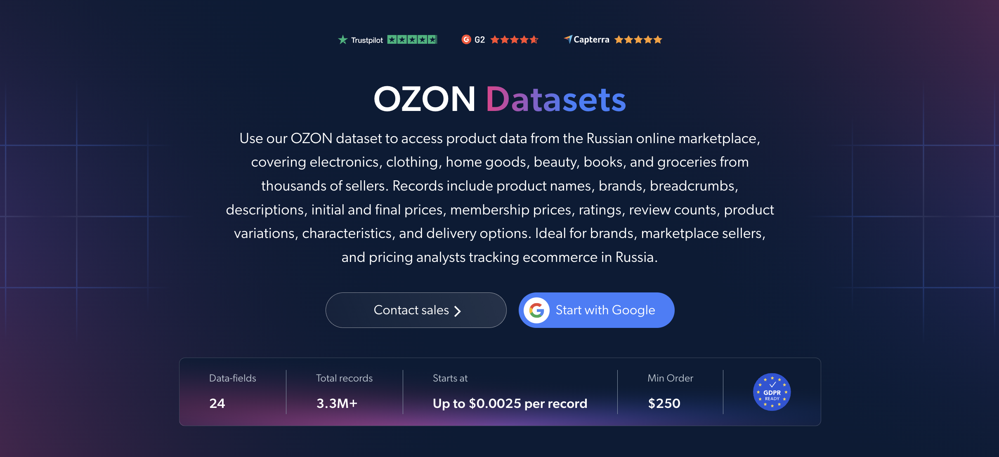

# Ozon-dataset-samples

<h2>A sample dataset of 1000 Ozon products</h2>

<a href="https://brightdata.com/products/datasets/ecommerce/ozon">
   
</a>

An Ozon dataset sample of 1000 products. Dataset was extracted using the <b>Bright Data API</b>.

<h2>Some of the data points that are included in the dataset:</h2>

* ```url```: URL of the Ozon product page
* ```sku```: Unique identifier for each product
* ```name```: Name of the product
* ```brand```: Brand or manufacturer of the product
* ```breadcrumbs```: Category path from root to leaf
* ```description```: Description of the product
* ```initial_price```: Original price before any discount
* ```final_price```: Final price after discount
* ```membership_price```: Special price for Ozon Premium members
* ```currency```: Currency of the product price
* ```rating```: Average customer rating
* ```review_count```: Number of customer reviews
* ```count_questions```: Number of customer questions about the product
* ```original_product```: Whether the product is marked as original
* ```product_variations```: All available variations, such as sizes or colors
* ```characteristics```: Key product features and specifications
* ```product_details```: Detailed product attributes
* ```delivery_options```: Available delivery options
* ```image```: URL of the main product image
* ```videos_url```: URLs of product videos

And a lot more.

This is a sample subset which is derived from the "Ozon.ru Products (public data)"
dataset which includes more than <b>3,300,000 products</b>.

Available dataset file formats: <b>JSON, NDJSON, JSON Lines, CSV, or Parquet. Optionally, files can be compressed to .gz</b>.

Dataset delivery type options: <b>Email, API download, Webhook, Amazon S3, Google Cloud storage, Google Cloud PubSub, Microsoft Azure, Snowflake, SFTP</b>.

Update frequency: <b>Once, Daily, Weekly, Monthly, Quarterly, Biannual, or Custom basis</b>.

Data enrichment available as an addition to the data points extracted: <b>Based on request.</b>

<b>[Get the full Ozon dataset](https://brightdata.com/products/datasets/ecommerce/ozon)</b>.

<a href="https://brightdata.com/products/datasets/ecommerce/ozon">
</a>

<h2>What are the Ozon datasets use cases?</h2>

<h3>1. Pricing optimization</h3>
Businesses use Ozon datasets to build pricing strategies and dynamic pricing models by comparing similar products across competitors. Tracking initial prices, final prices and Ozon Premium membership prices together reveals the real discount, pricing gaps and optimal price points in the Russian market.

<h3>2. Customer sentiment and product improvement</h3>
Brands analyze ratings, review counts and question counts to understand how consumers feel about specific products or the overall brand. A high question count next to few reviews often marks a product people want but do not yet trust, pointing to listings and offers that need improvement.

<h3>3. Brand and seller analysis</h3>
Companies use brands, categories, characteristics and delivery options to see which brands sell in each Ozon category and how their delivery terms compare. This helps size up competitors and find room to enter the marketplace.

<h2>Free access to web scraping tools and datasets for academic researchers and NGOs</h2>

The Bright Initiative offers access to Bright Data's <b>[Web Scraper APIs](https://brightdata.com/products/web-scraper)</b> and <b>[ready-to-use datasets](https://brightdata.com/products/datasets)</b> to leading academic faculties and researchers, NGOs and NPOs promoting various environmental and social causes. You can submit an application <b>[here](https://brightinitiative.com)</b>.
